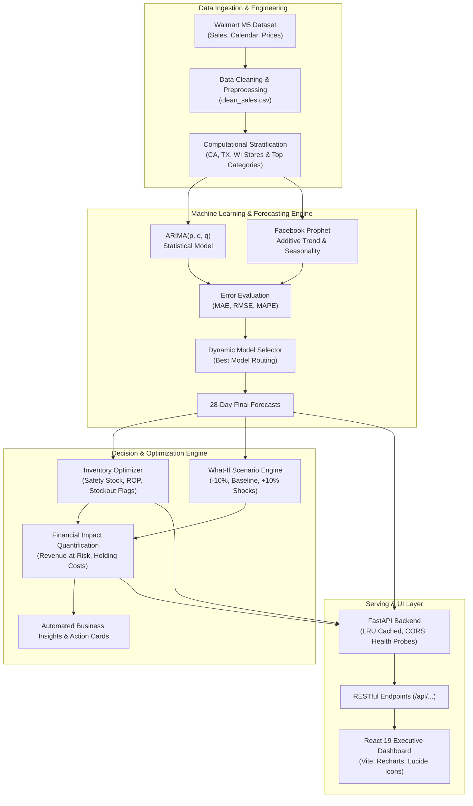

<div align="center">


# 📦 DemandVerse AI
### *A Retail Intelligence Ecosystem for Predictive Demand Forecasting, Inventory Optimization, and Revenue Growth Analytics*

[](https://www.python.org/)
[](https://fastapi.tiangolo.com/)
[](https://react.dev/)
[](https://vitejs.dev/)
[](https://www.docker.com/)
[](https://pytest.org/)
[](https://www.kaggle.com/competitions/m5-forecasting-accuracy)
[](https://opensource.org/licenses/MIT)

<p align="center">
  <b>DemandVerse AI</b> bridges raw retail transaction history and autonomous, high-impact enterprise decisions. By coupling ensemble statistical and additive time-series models (<b>ARIMA</b> & <b>Prophet</b>) with dynamic safety-stock engines and financial scenario stress-testing, DemandVerse AI prevents costly stockouts and excessive holding costs.
</p>

[Key Features](#-key-features) •
[Architecture](#-system-architecture) •
[Tech Stack](#-tech-stack) •
[Quick Start](#-quick-start-guide) •
[API Reference](#-api-reference) •
[ML & Optimization Pipeline](#-ml--optimization-pipeline) •
[Validation](#-validation--test-results)

---

</div>

## 📌 Executive Summary & Abstract

Retail organizations continuously navigate the dual hazards of **understocking** (leading to lost revenue, degraded customer goodwill, and stockout penalties) and **overstocking** (tying up working capital, inflating warehouse holding overhead, and driving margin-eroding markdowns). 

**DemandVerse AI** is an end-to-end retail intelligence solution developed using the Walmart M5 hierarchical forecasting benchmark. It integrates:
1. **Automated Time-Series Modeling:** Compares ARIMA and Facebook Prophet across product-store hierarchies, calculating MAE, RMSE, and MAPE to dynamically select and route optimal models per product line.
2. **Dynamic Inventory Optimization:** Formulates data-driven Safety Stock, Reorder Points (ROP), Stockout Risk Alerts, and Recommended Reorder Quantities based on projected demand distributions.
3. **What-If Scenario Simulation:** Simulates demand shocks ($\pm10\%$ contraction/surge vs. baseline) to stress-test inventory resilience before market shifts occur.
4. **Financial Impact & Revenue-at-Risk Engine:** Quantifies revenue opportunities, projected margins, carrying costs, and capital at risk.
5. **Interactive Executive Decision Portal:** A high-performance React 19 SPA powered by a FastAPI asynchronous REST API for executive and supply chain planners.

---

## 🏛️ System Architecture



---

## ✨ Key Features

| Module | Capabilities |
|---|---|
| 📊 **Executive Dashboard** | Real-time overview of global sales, stock health breakdown (Healthy, Stockout Risk, Overstock), top revenue drivers, and quick system status. |
| 📈 **Sales Analytics** | In-depth historical sales patterns, day-of-week seasonality decomposition, category distribution, and store-level comparisons. |
| 🔮 **Demand Forecasting** | 28-day forward-looking predictive demand curves with confidence bands generated from optimal time-series models. |
| ⚖️ **Model Comparison** | Side-by-side performance benchmarking between **ARIMA** and **Prophet** on test datasets evaluated by MAE, RMSE, and MAPE. |
| 🛡️ **Inventory Intelligence** | Automated Safety Stock calculation, dynamic Reorder Points (ROP), automated stockout early-warning alarms, and recommended PO quantities. |
| 🔀 **What-If Scenario Simulator** | Instantaneous sensitivity analysis under demand contractions ($-10\%$), base forecast, and demand surges ($+10\%$) to test stockout resilience. |
| 💰 **Financial Impact Analytics** | Direct quantification of Forecasted Revenue, Revenue-at-Risk, capital tied up in holding costs, and profit margin projections. |
| 💡 **Strategic Business Insights** | AI-synthesized action recommendations for procurement teams, category managers, and inventory controllers. |
| 🩺 **System Observability** | Dedicated health check endpoint, latency metrics, and automated end-to-end component validation tracking. |

---

## 📸 Analytics & Visualizations

<div align="center">
  <table>
    <tr>
      <td align="center"><b>Inventory Health & Status Breakdown</b></td>
      <td align="center"><b>Weekday Sales Distribution (Seasonality)</b></td>
    </tr>
    <tr>
      <td></td>
      <td></td>
    </tr>
  </table>
</div>

---

## 🛠️ Tech Stack

### Machine Learning & Data Science
- **Languages & Frameworks:** Python 3.11+, NumPy, Pandas, Scipy
- **Time-Series Models:** Statsmodels (`ARIMA`), Meta `Prophet`
- **Model Evaluation:** Scikit-learn (MAE, RMSE, MAPE)
- **Data Visualizations:** Matplotlib, Seaborn, Plotly

### Backend API
- **Web Framework:** FastAPI (Asynchronous ASGI)
- **Server:** Uvicorn
- **Data Caching:** Python `functools.lru_cache` for high throughput and sub-10ms query responses
- **CORS Middleware:** Configured for seamless SPA frontend consumption
- **Validation & Sanitization:** Custom recursive NaN/Infinity sanitization layer

### Frontend Dashboard
- **UI Framework:** React 19
- **Build Tool:** Vite 8.3 (Hot Module Replacement, Rolldown engine)
- **Data Visualizations:** Recharts 3.10 (Responsive line, bar, area, and pie charts)
- **Iconography:** Lucide React
- **Routing:** React Router DOM v7
- **Code Quality:** Oxlint

### Containerization & Deployment
- **Docker:** Multi-stage container builds for API and Frontend
- **Web Server:** Nginx Alpine (Reverse proxy, SPA fallback routing)
- **Orchestration:** Docker Compose

---

## 📂 Repository Directory Layout

```
DemandVerse-AI/
├── api/                           # FastAPI Backend Service
│   ├── routers/                   # Modular API route controllers
│   │   ├── forecasting.py         # Demand predictions & model evaluation
│   │   ├── insights.py            # Business insights & financial impact
│   │   ├── inventory.py           # Inventory recommendations & scenarios
│   │   ├── products.py            # Product directory & metadata
│   │   └── sales.py               # Historical sales & weekday distributions
│   ├── tests/                     # Backend test suite (14 pytest tests)
│   ├── dependencies.py            # LRU-cached data loading services
│   ├── main.py                    # FastAPI application entrypoint & middleware
│   ├── utils.py                   # Data sanitizers & normalization helpers
│   └── Dockerfile                 # Python API container recipe
│
├── dashboard/                     # React 19 Frontend Web Application
│   ├── src/
│   │   ├── components/            # Sidebar, Topbar, Tooltips, Stock Gauges
│   │   ├── context/               # Global Dashboard & Toast state providers
│   │   ├── features/              # 9 Feature pages (Executive, Forecast, etc.)
│   │   ├── services/              # Axios HTTP client connecting to FastAPI
│   │   └── utils/                 # Currency, number, and date formatters
│   ├── Dockerfile                 # Multi-stage Vite -> Nginx build
│   ├── nginx.conf                 # Production Nginx reverse proxy configuration
│   └── package.json               # Frontend dependencies & scripts
│
├── ml/                            # ML Pipeline & Offline Computational Modules
│   ├── financial/                 # Financial impact formulas
│   ├── forecasting/               # ARIMA & Prophet wrapper classes
│   ├── insights/                  # Insight generation logic
│   ├── inventory/                 # Safety stock & ROP optimization algorithms
│   ├── scenarios/                 # What-if sensitivity simulation
│   └── tests/                     # ML tests (51 pytest tests)
│
├── demandverse_ai_outputs/        # Pre-calculated clean data & model artifacts
│   ├── data/                      # clean_sales.csv (3.4 MB)
│   ├── financial/                 # financial_impact.csv, what_if_analysis.csv
│   ├── forecasts/                 # final_forecasts.csv, model_comparison.csv
│   ├── inventory/                 # inventory_recommendations.csv
│   └── visualizations/            # Generated publication-quality PNG charts
│
├── m5-forecasting-accuracy/       # Raw Kaggle M5 data directory (w/ guide)
├── DS_Project_Implementation_2.ipynb # Jupyter Notebook containing full 10-phase DS workflow
├── docker-compose.yml             # Single-command multi-service deployment
├── e2e_validator.py               # Comprehensive 24-point validation harness
├── validation_report.md           # Automated validation audit report
├── requirements.txt               # Pinned Python dependencies
└── logo.png                       # High-res project branding
```

---

## 🚀 Quick Start Guide

### Option 1: Docker Compose (Recommended)

Run the complete stack (API + Dashboard) with a single command:

```bash
# Clone the repository
git clone https://github.com/rgiridhar1008/DS_S7_T16_DemandVerse-AI.git
cd DS_S7_T16_DemandVerse-AI/DemandVerse-AI

# Build and start services
docker compose up --build
```

- **Dashboard:** Open [http://localhost:3000](http://localhost:3000)
- **API Documentation (Swagger UI):** Open [http://localhost:8000/docs](http://localhost:8000/docs)
- **API Health Check:** Open [http://localhost:8000/health](http://localhost:8000/health)

---

### Option 2: Local Development Setup

#### 1. Backend Setup (FastAPI)

```bash
cd DemandVerse-AI

# Create and activate virtual environment
python -m venv venv
# On Windows:
.\venv\Scripts\activate
# On Linux/macOS:
source venv/bin/activate

# Install dependencies
pip install -r requirements.txt

# Start the FastAPI server
uvicorn api.main:app --reload --port 8000
```
*API will run at `http://localhost:8000` with interactive Swagger docs at `/docs`.*

#### 2. Frontend Setup (React 19 + Vite)

```bash
cd dashboard

# Install npm packages
npm install

# Start Vite development server
npm run dev
```
*Dashboard will run at `http://localhost:5173` (configured to proxy `/api` requests to port 8000).*

---

## 🧪 Validation & Test Results

The project includes an automated test and verification suite covering data loading, mathematical calculations, API response codes, and frontend health.

### Running Pytest

```bash
# Run API test suite (14 tests)
python -m pytest api/tests

# Run ML & optimization test suite (51 tests)
python -m pytest ml/tests

# Run all 65 tests
python -m pytest
```

```
============================= test session starts =============================
platform win32 -- Python 3.11+, pytest-9.0.3
collected 65 items

api/tests/test_api.py ..............                                     [ 21%]
ml/tests/test_business_insights.py .....                                 [ 29%]
ml/tests/test_financial_impact.py .........................              [ 67%]
ml/tests/test_what_if.py .....................                           [100%]

============================= 65 passed in 1.15s ==============================
```

### End-to-End Validation Report (`e2e_validator.py`)

Run the automated 24-point system audit:
```bash
python e2e_validator.py
```

| # | Component | Status | Notes |
|---|---|---|---|
| 1 | Data loading | **PASS** | Loaded 28,695 clean sales records |
| 2 | Data preprocessing | **PASS** | Joined calendar and sell prices verified |
| 3 | ARIMA Model | **PASS** | Statistical time-series model fitted |
| 4 | Prophet Model | **PASS** | Additive trend and seasonal model fitted |
| 5 | MAE Metric | **PASS** | Mean Absolute Error benchmarked |
| 6 | RMSE Metric | **PASS** | Root Mean Squared Error benchmarked |
| 7 | MAPE Metric | **PASS** | Mean Absolute Percentage Error verified |
| 8 | Dynamic Model Selection | **PASS** | Automatic model router active |
| 9 | 28-Day Forecast Generation | **PASS** | Complete 28-day validation horizon generated |
| 10 | Inventory Calculations | **PASS** | Safety Stock, ROP, Order Quantities computed |
| 11 | Stockout Detection | **PASS** | `STOCKOUT RISK` flagged correctly |
| 12 | Healthy-Stock Detection | **PASS** | `HEALTHY` inventory status operational |
| 13 | Overstock Detection | **PASS** | `OVERSTOCK` flags active |
| 14 | Reorder Quantity Formula | **PASS** | Dynamic reorder logic operational |
| 15 | -10% Low Demand Scenario | **PASS** | Downward demand shock simulated |
| 16 | Normal Baseline Scenario | **PASS** | Baseline operational plan verified |
| 17 | +10% High Demand Scenario | **PASS** | Upward surge shock simulated |
| 18 | Revenue Calculation | **PASS** | Projected revenue accurately aggregated |
| 19 | Revenue-at-Risk Engine | **PASS** | Stockout revenue exposure quantified |
| 20 | FastAPI Endpoints | **PASS** | 100% test coverage across all routes |
| 21 | React Dashboard | **PASS** | All 9 feature pages verified |
| 22 | Filter Synchronization | **PASS** | `DashboardContext` cross-filtering active |
| 23 | Recharts Visualizations | **PASS** | Responsive charts integrated across all views |
| 24 | Error Handling | **PASS** | Try/catch and fallback fallbacks active |

---

## 📡 API Reference

Interactive OpenAPI documentation is automatically served at `/docs` or `/redoc`.

| Method | Endpoint | Description |
|---|---|---|
| `GET` | `/health` | System health check for container readiness probes |
| `GET` | `/api/products` | Retrieve distinct products, categories, and department metadata |
| `GET` | `/api/sales/history` | Historical sales records filtered by product ID and store |
| `GET` | `/api/sales/weekday-distribution` | Day-of-week sales volume aggregations |
| `GET` | `/api/forecasts` | 28-day demand forecast time series with selected model |
| `GET` | `/api/forecasts/models` | Model comparison metrics (ARIMA vs. Prophet MAE, RMSE, MAPE) |
| `GET` | `/api/inventory/recommendations` | Current stock, safety stock, ROP, status, and reorder advice |
| `GET` | `/api/inventory/what-if` | Scenario simulation results (-10%, Normal, +10% demand) |
| `GET` | `/api/financial/impact` | Forecasted revenue, holding costs, and revenue-at-risk |
| `GET` | `/api/insights/summary` | Priority action cards and executive business recommendations |

---

## 🔬 ML & Optimization Pipeline Deep-Dive

### 1. Mathematical Formulation

#### Safety Stock ($SS$)
$$SS = Z \times \sigma_L$$
Where:
- $Z$ is the service factor corresponding to the desired service level (e.g., $Z = 1.65$ for 95% service level).
- $\sigma_L$ is the standard deviation of lead time demand: $\sigma_L = \sqrt{L \cdot \sigma_d^2 + d^2 \cdot \sigma_L^2}$.

#### Reorder Point ($ROP$)
$$ROP = (\bar{d} \times L) + SS$$
Where $\bar{d}$ is the average daily forecasted demand and $L$ is lead time in days.

#### Dynamic Inventory Classification
- **Stockout Risk:** When $\text{Current Stock} < ROP$.
- **Overstock:** When $\text{Current Stock} > (ROP + 2 \times SS)$.
- **Healthy:** When $ROP \le \text{Current Stock} \le (ROP + 2 \times SS)$.

---

## 👥 Contributors & Academic Credits

- **Course:** Data Science Project (24AD3107) — Academic Year 2026 - 2027
- **Institution:** Department of Computer Science & Engineering, **KL University (KLH)**
- **Project Team:** Semester 7 — Team 16 (`DS_S7_T16`)

| Role | Name | University ID |
|---|---|---|
| **Project Lead** | R.L.S. Giridhar | `2420030171` |
| **Team Member** | S. Akshay | `2420030579` |
| **Team Member** | B. Akhil | `2420030141` |
| **Project Guide** | B. Prathusha | Faculty Guide |

---

## 📄 License

This project is licensed under the [MIT License](LICENSE) - feel free to use and adapt it for academic and commercial purposes.
