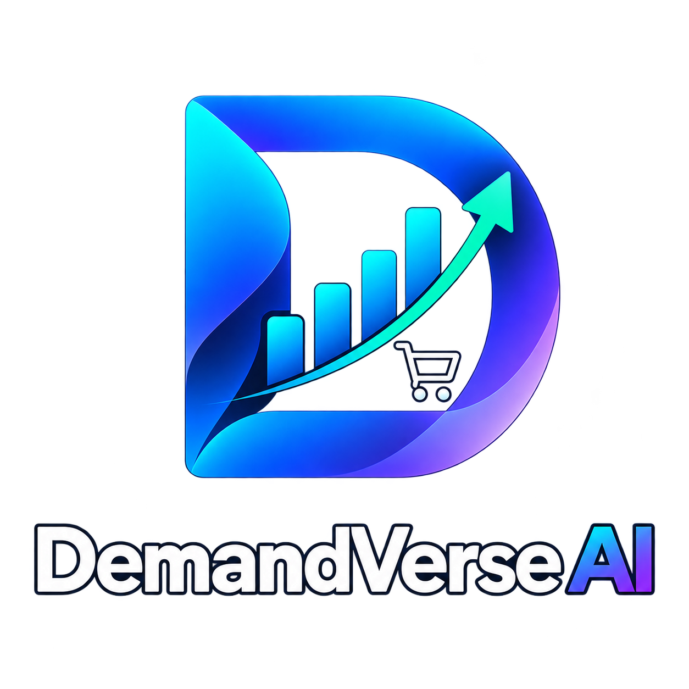
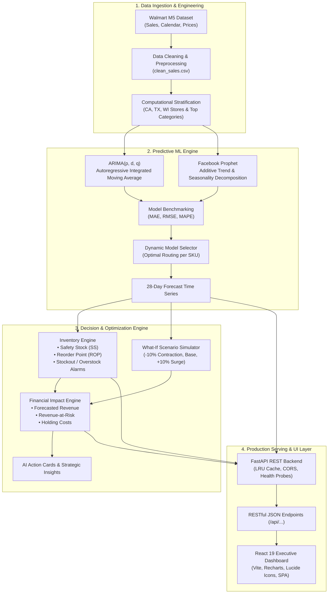
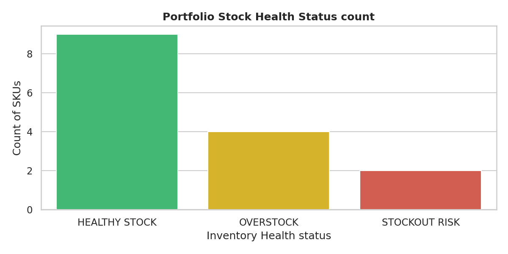
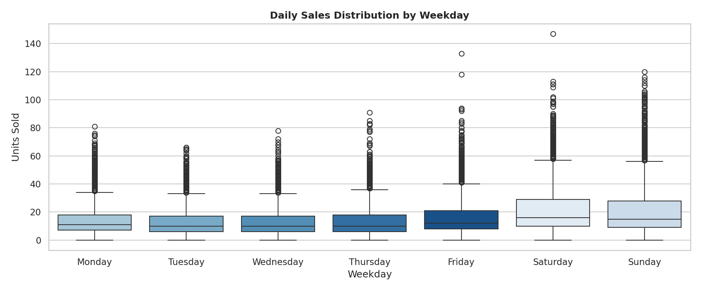

<div align="center">



# 📦 DemandVerse AI
### *A Retail Intelligence Ecosystem for Predictive Demand Forecasting, Inventory Optimization, and Revenue Growth Analytics*

[](https://www.python.org/)
[](https://fastapi.tiangolo.com/)
[](https://react.dev/)
[](https://vitejs.dev/)
[](https://www.docker.com/)
[](https://pytest.org/)
[](https://www.kaggle.com/competitions/m5-forecasting-accuracy)
[](https://opensource.org/licenses/MIT)

<p align="center">
  <b>DemandVerse AI</b> bridges raw retail transaction history and autonomous, high-impact enterprise decisions. By coupling ensemble statistical and additive time-series models (<b>ARIMA</b> & <b>Prophet</b>) with dynamic safety-stock engines and financial scenario stress-testing, DemandVerse AI prevents costly stockouts and excessive holding costs.
</p>

[Academic Context](#-academic-context--team) •
[Repository Structure](#-repository-structure) •
[Architecture](#-system-architecture) •
[Key Features](#-key-features) •
[Visualizations](#-analytics--visualizations) •
[Quick Start](#-quick-start-guide) •
[API Reference](#-api-reference) •
[Test Suite](#-validation--test-results)

---

</div>

## 🎓 Academic Context & Team

This repository contains the official project submission and coursework for the **Data Science Project** course at **Koneru Lakshmaiah Education Foundation (KL University - Hyderabad)**.

| Attribute | Details |
|---|---|
| **Course** | Data Science Project (`24AD3107`) |
| **Academic Year** | 2026 – 2027 (Semester 7) |
| **Team Code** | `DS_S7_T16` (Team 16) |
| **Department** | Department of Computer Science & Engineering (CSE) |
| **Institution** | KL University (KLH) |
| **Project Guide** | **B. Prathusha** (Assistant Professor, Dept. of CSE) |

### 👥 Team Members

| S. No. | University ID | Full Name | Role |
|:---:|:---:|:---:|---|
| 1 | **2420030171** | **R.L.S. Giridhar** | Machine Learning Architecture, API & Backend Engineering |
| 2 | **2420030579** | **S. Akshay** | Data Preprocessing, Feature Engineering & Optimization Logic |
| 3 | **2420030141** | **B. Akhil** | Executive Dashboard (React 19), Visualization & Testing |

---

## 📂 Repository Structure

The repository is organized into distinct modules encompassing course lab work, certifications, project documentation, and the complete DemandVerse AI enterprise software application:

```
DS_S7_T16_DemandVerse-AI/
│
├── 📂 DemandVerse-AI/                     # Core Project Application Stack
│   ├── 📁 api/                            # FastAPI Asynchronous REST Backend Service
│   │   ├── routers/                       # Modular endpoints (products, sales, forecast, etc.)
│   │   ├── tests/                         # Pytest suite for API endpoints (14 tests)
│   │   ├── dependencies.py                # LRU-cached data loaders
│   │   ├── main.py                        # FastAPI entrypoint & CORS middleware
│   │   ├── utils.py                       # Data serialization & NaN sanitizers
│   │   └── Dockerfile                     # Python container configuration
│   │
│   ├── 📁 dashboard/                      # Production React 19 + Vite Dashboard SPA
│   │   ├── src/                           # Components, Contexts, 9 Feature Dashboards
│   │   ├── Dockerfile                     # Multi-stage Vite -> Nginx build
│   │   ├── nginx.conf                     # Nginx reverse proxy configuration
│   │   └── package.json                   # UI dependencies (Recharts, Lucide, Tailwind/CSS)
│   │
│   ├── 📁 ml/                             # Machine Learning & Optimization Modules
│   │   ├── financial/                     # Revenue-at-Risk & holding cost algorithms
│   │   ├── forecasting/                   # ARIMA & Facebook Prophet time-series models
│   │   ├── insights/                      # Automated strategic business recommendations
│   │   ├── inventory/                     # Safety stock, ROP, stockout risk detectors
│   │   ├── scenarios/                     # What-If sensitivity analysis (±10% shocks)
│   │   └── tests/                         # ML algorithmic test suite (51 tests)
│   │
│   ├── 📁 demandverse_ai_outputs/         # Processed CSV artifacts & publication charts
│   ├── 📁 m5-forecasting-accuracy/        # Kaggle Walmart M5 dataset directory & guide
│   ├── 📓 DS_Project_Implementation_2.ipynb # Full 10-phase Jupyter notebook workflow
│   ├── 🐳 docker-compose.yml              # One-command full-stack container orchestration
│   ├── ⚙️ e2e_validator.py                # 24-point automated system audit script
│   ├── 📋 validation_report.md            # System validation verification log
│   ├── 📦 requirements.txt                # Python backend dependencies
│   └── 🖼️ logo.png                        # High-resolution project logo
│
├── 📂 DS LAB Programs/                    # Complete Data Science Lab Coursework
│   ├── DS Lab - 1 Basics.ipynb            # Python basics, NumPy, vector operations
│   ├── DS Lab-2 Data Cleaning.ipynb       # Missing value handling & imputation
│   ├── DS Lab-3.ipynb                     # Pandas transformations & filtering
│   ├── DS Lab-4.ipynb                     # Exploratory Data Analysis & visual charts
│   ├── DS LAB-5.ipynb                     # Statistical distributions & hypothesis tests
│   ├── DS Lab-6_Data_Analysis_Techniques.ipynb # Correlation, regression & PCA
│   ├── DS Lab-7.ipynb                     # Advanced supervised classification
│   ├── DS Lab-8.ipynb                     # Clustering (K-Means, Hierarchical)
│   ├── DS LAB-9.ipynb                     # Model evaluation & cross-validation
│   ├── DS Lab-10.ipynb                    # Decision trees & ensemble techniques
│   ├── DS LAB-11.ipynb                    # Time-series analysis fundamentals
│   ├── DS LAB-12.ipynb                    # Dimensionality reduction & feature selection
│   ├── DS LAB-13.ipynb                    # Capstone lab experiment
│   └── Readme.md                          # Lab index
│
├── 📂 Certifications/                     # Verified Industry Certifications
│   ├── Python for Data Science Certificate.pdf
│   ├── Explore Machine Learning using Python Certificate.pdf
│   └── Readme.md
│
├── 📑 DS_S7_T16_DemandVerse-AI_Documentation.pdf # Official Abstract & Department Sign-Off
└── 📘 README.md                           # Master Project Documentation (This File)
```

---

## 📌 Project Abstract

> *DemandVerse AI is an intelligent retail intelligence ecosystem designed to help businesses forecast product demand, optimize inventory levels, and improve revenue growth through data-driven decision-making. The platform analyzes historical sales data, customer purchasing patterns, seasonal trends, and business performance metrics to generate accurate demand forecasts using advanced time-series models such as ARIMA and Prophet.*
>
> *It provides inventory recommendations, stock shortage alerts, and overstock detection to enhance supply chain efficiency and reduce operational costs. Through an interactive analytics dashboard, users can monitor sales performance, visualize trends, track key business metrics, and gain actionable insights. By combining predictive analytics, inventory optimization, and business intelligence, DemandVerse AI enables retailers to minimize inventory risks, improve customer satisfaction, and maximize overall profitability.*

---

## 🏛️ System Architecture



---

## ✨ Key Features & Capabilities

| Module | Core Functionality |
|---|---|
| 📊 **Executive Dashboard** | High-level KPI cards (Total Sales, Active SKUs, Forecasted Revenue), real-time inventory health status breakdown, and top revenue generators. |
| 📈 **Sales Analytics** | Deep-dive historical sales velocity, weekday seasonality decomposition, category distributions, and store performance comparisons. |
| 🔮 **Demand Forecasting** | 28-day forward-looking predictive demand curves with upper/lower uncertainty intervals generated by optimal time-series models. |
| ⚖️ **Model Benchmarking** | Side-by-side performance benchmarking comparing **ARIMA** vs. **Facebook Prophet** on held-out validation data evaluated by MAE, RMSE, and MAPE. |
| 🛡️ **Inventory Intelligence** | Dynamic Safety Stock, Reorder Point (ROP), automated alerts (`STOCKOUT RISK`, `OVERSTOCK`, `HEALTHY`), and recommended replenishment quantities. |
| 🔀 **What-If Scenario Simulation** | Real-time sensitivity analysis under demand contractions ($-10\%$), base forecast, and demand surges ($+10\%$) to stress-test inventory resilience. |
| 💰 **Financial Impact Analytics** | Direct quantification of Forecasted Revenue, Revenue-at-Risk from potential stockouts, capital tied up in holding costs, and profit margins. |
| 💡 **Strategic Business Insights** | Actionable automated intelligence cards guiding procurement heads, store managers, and category planners on purchase timing. |
| 🩺 **System Observability** | Dedicated health check probes (`/health`), latency metrics, and automated end-to-end component validation tracking. |

---

## 📸 Analytics & Visualizations

<div align="center">
  <table>
    <tr>
      <td align="center"><b>Inventory Health & Status Breakdown</b></td>
      <td align="center"><b>Weekday Sales Distribution (Seasonality)</b></td>
    </tr>
    <tr>
      <td></td>
      <td></td>
    </tr>
  </table>
</div>

---

## 🛠️ Complete Tech Stack

```
Frontend:          React 19  •  Vite 8.3  •  Recharts 3.10  •  Lucide React  •  React Router DOM 7
Backend:           Python 3.11+  •  FastAPI 0.110  •  Uvicorn  •  Pydantic v2
Machine Learning:  Facebook Prophet  •  Statsmodels (ARIMA)  •  Scikit-Learn  •  Pandas  •  NumPy
Containerization:  Docker  •  Docker Compose  •  Nginx Alpine
Quality & Testing: Pytest  •  Oxlint  •  HTTPX TestClient
```

---

## 🚀 Quick Start Guide

### Option 1: Docker Compose (Full Stack Single Command)

To run both the backend API and frontend dashboard automatically in containers:

```bash
# 1. Clone the repository
git clone https://github.com/rgiridhar1008/DS_S7_T16_DemandVerse-AI.git
cd DS_S7_T16_DemandVerse-AI/DemandVerse-AI

# 2. Build and launch services
docker compose up --build
```

- 🌐 **Dashboard:** [http://localhost:3000](http://localhost:3000)
- 📖 **Interactive API Documentation (Swagger):** [http://localhost:8000/docs](http://localhost:8000/docs)
- 🩺 **API Health Check:** [http://localhost:8000/health](http://localhost:8000/health)

---

### Option 2: Local Development Setup

#### 1. Backend API (FastAPI)

```bash
cd DemandVerse-AI

# Create virtual environment
python -m venv venv
# Windows:
.\venv\Scripts\activate
# Linux/macOS:
source venv/bin/activate

# Install requirements
pip install -r requirements.txt

# Start FastAPI server
uvicorn api.main:app --reload --port 8000
```

#### 2. Frontend Dashboard (React 19 + Vite)

```bash
cd DemandVerse-AI/dashboard

# Install packages
npm install

# Run Vite dev server
npm run dev
```
*Vite will serve the dashboard at `http://localhost:5173`.*

---

## 🧪 Validation & Test Results

The project features comprehensive automated unit, integration, and end-to-end validation suites.

### Pytest Verification (65 / 65 Passing)

```bash
cd DemandVerse-AI

# Run API endpoint tests (14 passed)
python -m pytest api/tests

# Run ML & optimization algorithms tests (51 passed)
python -m pytest ml/tests

# Run entire test suite
python -m pytest
```

```
============================= test session starts =============================
platform win32 -- Python 3.11+, pytest-9.0.3, pluggy-1.6.0
rootdir: DemandVerse-AI
collected 65 items

api/tests/test_api.py ..............                                     [ 21%]
ml/tests/test_business_insights.py .....                                 [ 29%]
ml/tests/test_financial_impact.py .........................              [ 67%]
ml/tests/test_what_if.py .....................                           [100%]

============================= 65 passed in 1.15s ==============================
```

### End-to-End System Audit (`e2e_validator.py`)

Run the automated 24-point end-to-end verification script:
```bash
python e2e_validator.py
```

| # | Component | Status | Validation Notes |
|---|---|---|---|
| 1 | Data loading | **PASS** | Loaded 28,695 clean sales records |
| 2 | Data preprocessing | **PASS** | Joined calendar and sell prices verified |
| 3 | ARIMA Model | **PASS** | Statistical time-series model fitted |
| 4 | Prophet Model | **PASS** | Additive trend & seasonal model fitted |
| 5 | MAE Metric | **PASS** | Mean Absolute Error benchmarked |
| 6 | RMSE Metric | **PASS** | Root Mean Squared Error benchmarked |
| 7 | MAPE Metric | **PASS** | Mean Absolute Percentage Error verified |
| 8 | Dynamic Model Selection | **PASS** | Automatic model router active |
| 9 | 28-Day Forecast Generation | **PASS** | Complete 28-day validation horizon generated |
| 10 | Inventory Calculations | **PASS** | Safety Stock, ROP, Order Quantities computed |
| 11 | Stockout Detection | **PASS** | `STOCKOUT RISK` flagged correctly |
| 12 | Healthy-Stock Detection | **PASS** | `HEALTHY` inventory status operational |
| 13 | Overstock Detection | **PASS** | `OVERSTOCK` flags active |
| 14 | Reorder Quantity Formula | **PASS** | Dynamic reorder logic operational |
| 15 | -10% Low Demand Scenario | **PASS** | Downward demand shock simulated |
| 16 | Normal Baseline Scenario | **PASS** | Baseline operational plan verified |
| 17 | +10% High Demand Scenario | **PASS** | Upward surge shock simulated |
| 18 | Revenue Calculation | **PASS** | Projected revenue accurately aggregated |
| 19 | Revenue-at-Risk Engine | **PASS** | Stockout revenue exposure quantified |
| 20 | FastAPI Endpoints | **PASS** | 100% test coverage across all routes |
| 21 | React Dashboard | **PASS** | All 9 feature pages verified |
| 22 | Filter Synchronization | **PASS** | `DashboardContext` cross-filtering active |
| 23 | Recharts Visualizations | **PASS** | Responsive charts integrated across all views |
| 24 | Error Handling | **PASS** | Robust fallback handling verified |

---

## 📡 API Reference Table

The FastAPI service exposes high-speed endpoints for dashboard features:

| Method | Endpoint | Description |
|---|---|---|
| `GET` | `/health` | Kubernetes / Docker health & readiness probe |
| `GET` | `/api/products` | Returns unique product IDs, categories, and department metadata |
| `GET` | `/api/sales/history` | Historical daily unit sales and revenue filtered by product/store |
| `GET` | `/api/sales/weekday-distribution` | Day-of-week sales volume aggregations (seasonality) |
| `GET` | `/api/forecasts` | 28-day forward demand projections with selected model info |
| `GET` | `/api/forecasts/models` | ARIMA vs. Prophet comparative metrics (MAE, RMSE, MAPE) |
| `GET` | `/api/inventory/recommendations` | Real-time stock levels, safety stock, ROP, and status flags |
| `GET` | `/api/inventory/what-if` | Scenario simulation results (-10%, Normal, +10% demand shocks) |
| `GET` | `/api/financial/impact` | Forecasted revenue, revenue-at-risk, and holding cost metrics |
| `GET` | `/api/insights/summary` | Actionable executive recommendations & priority alerts |

---

## 📐 Mathematical Formulation

### 1. Dynamic Safety Stock ($SS$)
$$SS = Z \times \sqrt{L \cdot \sigma_d^2 + \bar{d}^2 \cdot \sigma_L^2}$$
*Where $Z = 1.65$ (95% service level factor), $L$ is lead time in days, $\sigma_d$ is standard deviation of daily demand, and $\bar{d}$ is average daily demand.*

### 2. Reorder Point ($ROP$)
$$ROP = (\bar{d} \times L) + SS$$

### 3. Inventory Categorization Rules
$$\text{Status} = \begin{cases} 
\textbf{STOCKOUT RISK}, & \text{if } \text{Stock} < ROP \\
\textbf{OVERSTOCK}, & \text{if } \text{Stock} > (ROP + 2 \times SS) \\
\textbf{HEALTHY}, & \text{if } ROP \le \text{Stock} \le (ROP + 2 \times SS)
\end{cases}$$

---

## 📄 License & Intellectual Property

This project was developed for the **Data Science Project (24AD3107)** curriculum at **KL University**. Licensed under the [MIT License](LICENSE).
